# Light Control Card

[](https://hacs.xyz)
[](https://github.com/kedube/ha-light-control/releases/latest)
[](https://github.com/kedube/ha-light-control/actions/workflows/release.yml)
[](LICENSE)

Every light and outlet in your home, found automatically and shown in a 3D model of your house, rendered with real light and shadow under a sky that follows the sun. Turn the house with a finger, open a floor like a dollhouse, watch each room light up as you switch it, and control lights and outlets separately for the whole home, a floor or a single room.

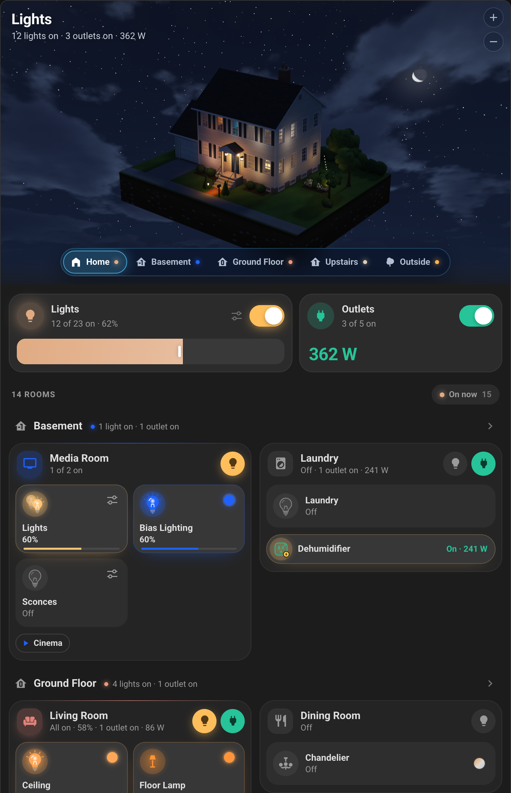

## Highlights

- **Your home in 3D.** The card builds a model of your house from your Home Assistant floors and areas and renders it with real light: sun and moon shadows, lamps that light their rooms, glass you can see through. Every room shows through its windows in the color and brightness of its lights, and outdoor areas become a garden, a porch or a driveway with their own lamps.
- **Turn it, come closer.** Drag to turn the house and look at it from any side, pinch or use the buttons to zoom. Open a floor and the roof lifts away, along with whichever walls are between you and the rooms.
- **Thirteen designs.** Colonial, Cape Cod, bungalow, ranch, craftsman, Victorian, mid-century modern, farmhouse, Mediterranean, Tudor, contemporary and more, each with its own roof, windows, porch and a garden to match. Pick the one closest to your house and paint it your own colors.
- **A sky that is alive.** The sky is worked out from where the sun really is: blue at noon, red at sunset, deep blue at dusk, stars and the moon in its true phase at night. Clouds drift, stars twinkle, and the clouds can follow your weather.
- **Life around the house.** Now and then a bird flies by, never the same way twice: a pair of small birds, swallows in summer, gulls, a crow, geese in their V in spring and autumn, a hawk circling overhead. Bats come out at summer dusk, fireflies glow in the garden on summer nights, and shooting stars cross the night sky. A plane may pass, with a trail by day or blinking lights at night, or a satellite. On cold days, with a weather entity, smoke drifts from the chimney with the wind.
- **Open any floor like a dollhouse.** Rooms are furnished so you can tell the kitchen from the bedroom, and every light has a lamp of its own. Tap a room to see it up close.
- **Lights and outlets, separately.** The whole home, each floor and each room have their own **Lights** and **Outlets** controls, so switching the lights never cuts power to a fridge or a computer. Turning several outlets off at once takes a second tap, and everything can be undone.
- **On, dim and color for every light.** Tap a tile to switch it, slide across it to dim, or press and hold for brightness, color, white temperature and effects. In a room up close, every light has its own switch, slider and color button.
- **Calm, even with a lot of devices.** Rooms are grouped by floor, outlets sit on a line of their own under the lights, and **On now** shows only what is on.
- **No entity lists to maintain.** Lights and outlets are discovered from your areas and floors. New devices appear on their own, and removed ones disappear.
- **Fits any screen.** Rooms sit side by side on a wide dashboard, two tiles to a row on a phone, and the controls move beside the color wheel on short wall tablets.
- **Smart plugs done right.** Live wattage, a 24-hour power chart, energy, voltage and current, on a faceplate drawn in your country's socket style.
- **Undo.** Switching lights or outlets off remembers each light's brightness and color, so one tap brings everything back.
- **Instant feedback.** Tiles and the house react immediately, even while slow Zigbee or cloud bulbs catch up.
- **Eight languages.** English, Deutsch, Nederlands, Français, Español, Italiano, Polski and Português, following each person's Home Assistant language.
- **Accessible.** Keyboard control, screen-reader labels, reduced-motion support, and light and dark themes.

|                                                                              A floor, opened up                                                                              |                                                                                           One room up close                                                                                            |
| :--------------------------------------------------------------------------------------------------------------------------------------------------------------------------: | :----------------------------------------------------------------------------------------------------------------------------------------------------------------------------------------------------: |
| 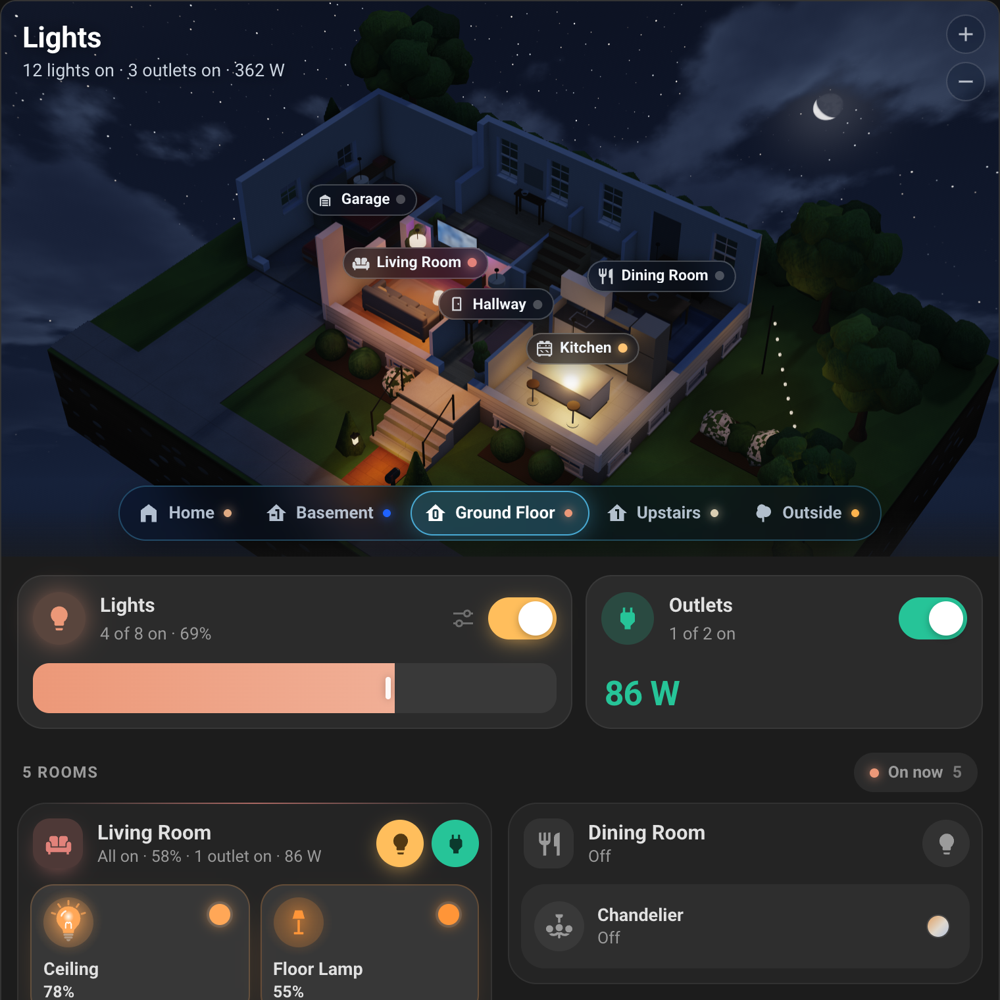 | 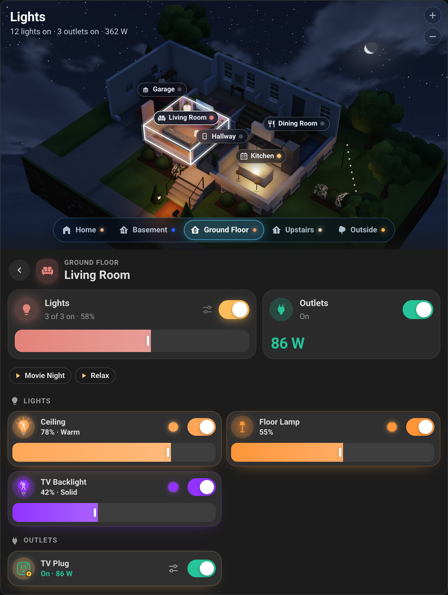 |

|                                                                              Upstairs, in daylight                                                                              |                                                               At dusk                                                                |
| :-----------------------------------------------------------------------------------------------------------------------------------------------------------------------------: | :----------------------------------------------------------------------------------------------------------------------------------: |
| 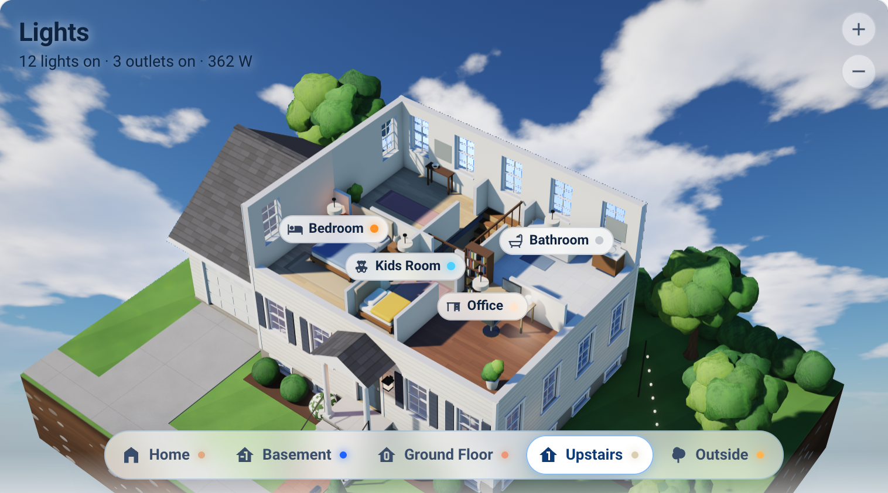 | 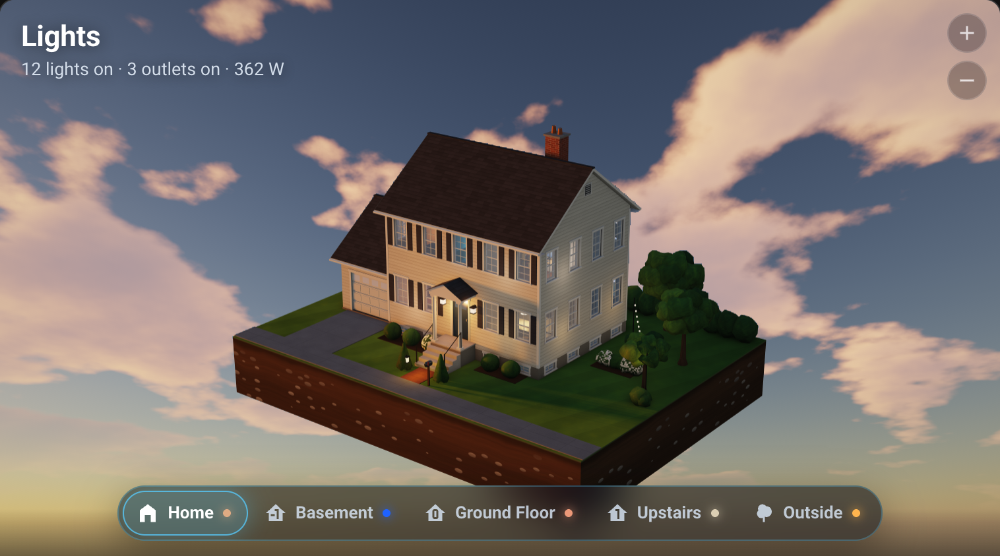 |

|                                                                    Color and white                                                                    |                                                                        Smart plugs                                                                        |                                                                          Lights and outlets for the whole home                                                                          |
| :---------------------------------------------------------------------------------------------------------------------------------------------------: | :-------------------------------------------------------------------------------------------------------------------------------------------------------: | :-------------------------------------------------------------------------------------------------------------------------------------------------------------------------------------: |
| 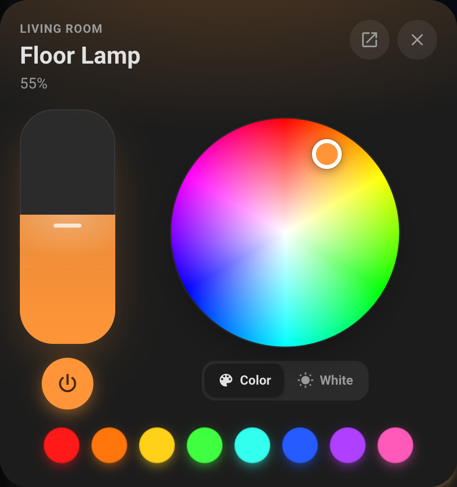 | 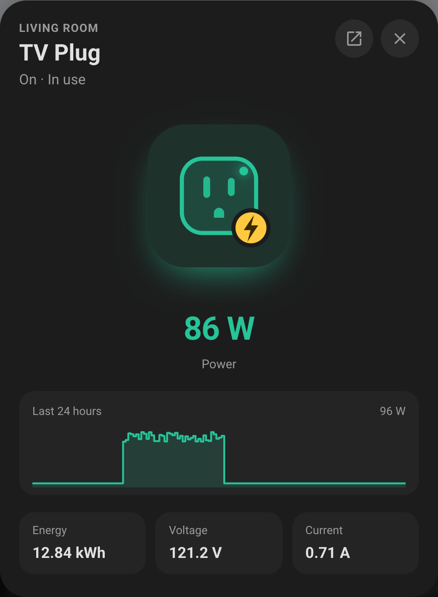 | 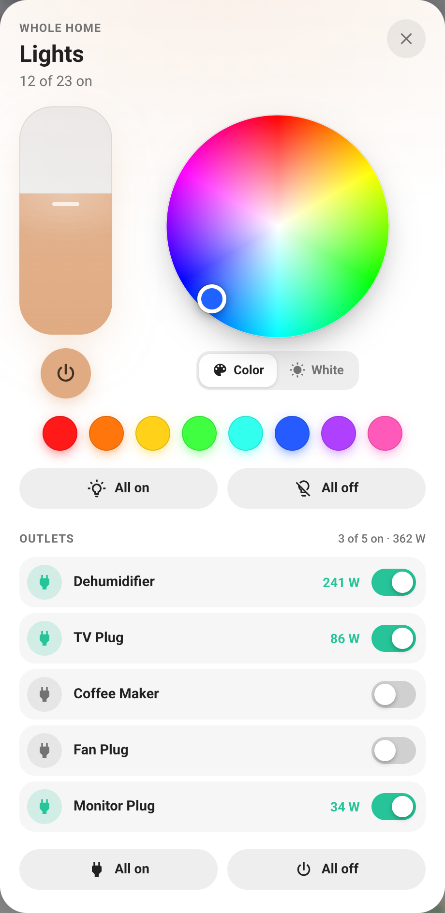 |

|                                                              Daytime, light theme                                                              |                                                                      On a phone                                                                      |
| :--------------------------------------------------------------------------------------------------------------------------------------------: | :--------------------------------------------------------------------------------------------------------------------------------------------------: |
| 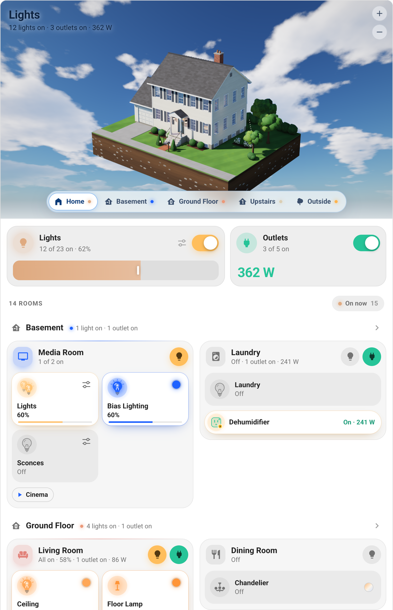 | 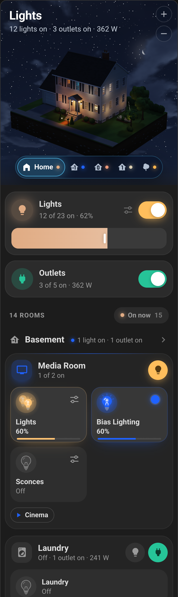 |

|                                                                          A Tudor, from the same rooms                                                                          |                                                                                 A Mediterranean house                                                                                 |
| :----------------------------------------------------------------------------------------------------------------------------------------------------------------------------: | :-----------------------------------------------------------------------------------------------------------------------------------------------------------------------------------: |
| 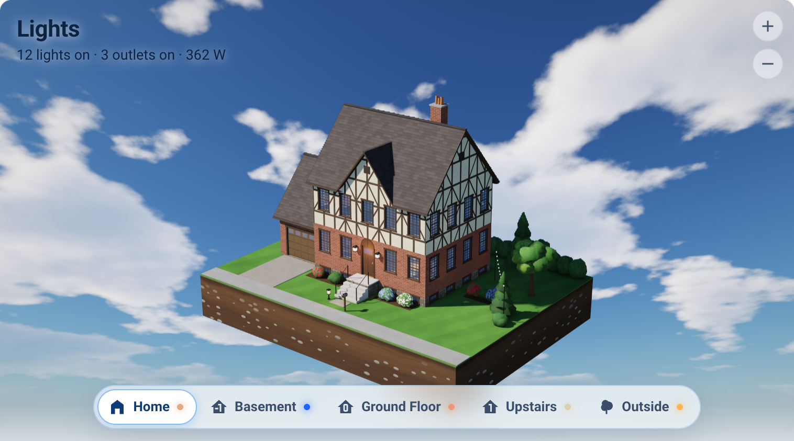 | 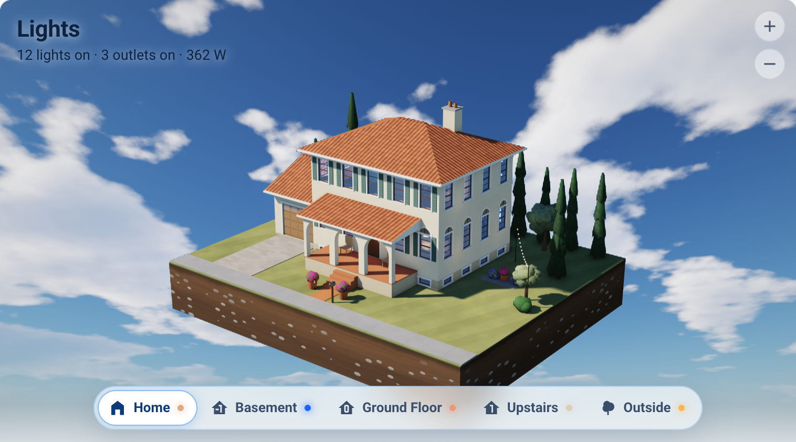 |

|                                                               Mid-century modern, at dusk                                                               |                                                     Turned to look at the back                                                     |
| :-----------------------------------------------------------------------------------------------------------------------------------------------------: | :--------------------------------------------------------------------------------------------------------------------------------: |
| 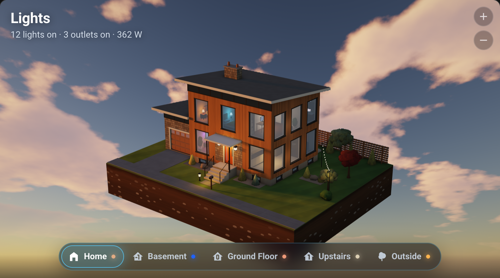 | 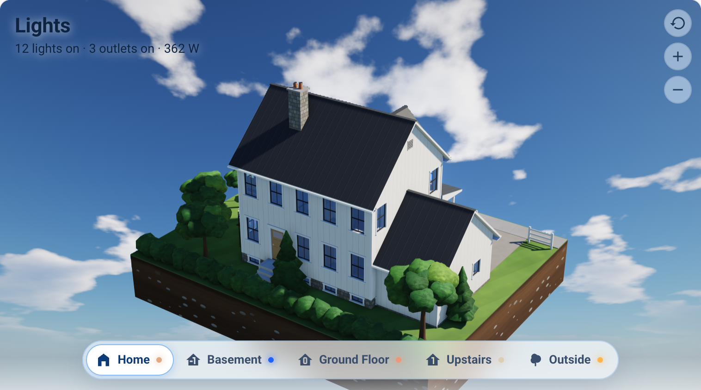 |

|                                                                             In a panel view                                                                              |
| :----------------------------------------------------------------------------------------------------------------------------------------------------------------------: |
| 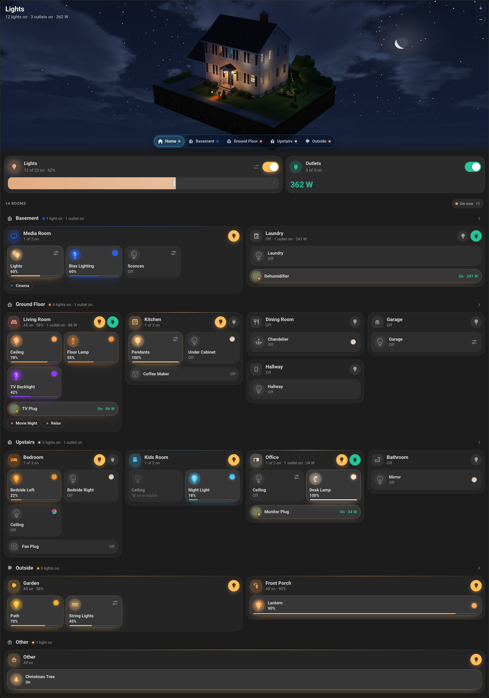 |

## Installation

### HACS (recommended)

[](https://my.home-assistant.io/redirect/hacs_repository/?owner=kedube&repository=ha-light-control&category=plugin)

1. Open **HACS** and search for **Light Control Card**, or select the button above to go straight to it.
2. Select **Download**.
3. Reload the browser. In the companion app, clear the frontend cache from **Settings → Companion app → Debugging**.

HACS registers the dashboard resource for you and offers updates whenever a new version is released.

### Manual

1. Download `ha-light-control.js` from the [latest release](https://github.com/kedube/ha-light-control/releases/latest).
2. Copy it to `config/www/ha-light-control.js` in your Home Assistant configuration folder.
3. Go to **Settings → Dashboards**, open the **⋮** menu, choose **Resources**, and add `/local/ha-light-control.js` as a **JavaScript module**. (Resources appear only with **Advanced mode** turned on in your user profile.)
4. Reload the browser.

When you update manually, add a version to the resource URL (for example `/local/ha-light-control.js?v=0.4`) so browsers fetch the new file.

**Requirements:** Home Assistant 2024.11 or newer. The 3D house is drawn with WebGL 2, which every current browser and the companion apps have; where it is missing, the card shows outlines of the rooms instead and everything else works the same.

## Add the card

Edit a dashboard, select **Add card**, and search for **Light Control**. The whole configuration is one line:

```yaml
type: custom:light-control-card
```

Every option is also available in the visual editor, grouped into Display, Plugs & outlets, Rooms, Entities and Behavior.

The card works in any view and adapts to the space it gets. For a whole-house lighting dashboard, give it a **Panel** view or a wide section, and the rooms sit side by side in columns.

## Using the card

**Places.** The switcher over the house moves between the whole home, each floor from the lowest up, and the outdoors. The house follows: the whole home from outside, a floor opened up like a dollhouse, or the garden.

**The house.** Drag sideways to turn it and up or down to tip it; pinch, hold Ctrl while scrolling, or use the **+** and **−** buttons to zoom. A button appears to put the view back. An up-and-down swipe still scrolls the page.

**Lights and Outlets.** Under the house, two controls act on the place you are looking at:

| Control     | What it does                                                                                                                                                                                                                                      |
| ----------- | ------------------------------------------------------------------------------------------------------------------------------------------------------------------------------------------------------------------------------------------------- |
| **Lights**  | The switch turns every light off (with **Undo**), or all of them on. The slider dims the lights that are on and leaves the others off; with nothing on, it turns them all on at that level. Tap **Lights** for color, white temperature and more. |
| **Outlets** | The switch turns the outlets on or off, and shows how much power they draw. When it would turn off more than one, the first tap asks and the second one does it.                                                                                  |

Every room card has the same two switches in small: a bulb for its lights and a plug for its outlets.

**Rooms.** Tap a room's name, a window in the house, or a room on an open floor to see it up close: the house shows where it is, and every light gets its own switch, brightness slider and color button. The arrow goes back to its floor.

| Gesture on a tile                                        | On a light                                                       | On an outlet                           |
| -------------------------------------------------------- | ---------------------------------------------------------------- | -------------------------------------- |
| **Tap**                                                  | Turn on or off                                                   | Turn on or off                         |
| **Slide sideways**                                       | Set the brightness; slide to the far left to turn it off         | —                                      |
| **Press and hold**, right-click, or tap the round button | Open the controls: brightness, color, white temperature, effects | Open power, energy and a 24-hour chart |

| Elsewhere       | What it does                                   |
| --------------- | ---------------------------------------------- |
| **Scene chips** | Activate a scene assigned to the room.         |
| **On now**      | Shows only the lights and outlets that are on. |

With a keyboard, **Tab** moves between tiles, **Enter** or **Space** toggles, and the arrow keys change brightness in 10% steps. The arrow keys also move between the places over the house, and every slider and color wheel works with them. With a room in the house focused, the arrow keys turn the house, **+** and **−** zoom, and **0** puts the view back.

## How the house is built

The 3D house comes from the floors and areas you already have in Home Assistant, so there is nothing to draw.

- **Floors become stories**, in the order of their levels: basements below the grass, the ground floor with the front door, and the floors above. Rooms without a floor move in on the ground floor. A home without floors becomes a one-story house.
- **The top floor can be under the roof.** A floor named Attic or Loft (in any of the card's languages) is built into the roof, with sloping ceilings, dormer windows and windows in the gables, so a house with two floors and an attic looks like one. Story-and-a-half designs (Cape Cod, bungalow, craftsman, the European house) put their upper floor there too; taller designs do the same for a third floor. `house_top_floor` decides it for you. The dormers stand in a row over the windows below, symmetrical about the middle of the roof, and `house_dormers` turns them on or off.
- **Rooms are recognized by name**, in any of the card's languages, or by their area icon: living rooms get a sofa and a TV, kitchens counters and an island, bedrooms a bed and nightstands, garages a car. The kind of room also decides how big it is.
- **The front is set out as a builder would.** The walls are divided into bays of one width, with a window of one size in the middle of each, the same either side of the front door in the middle, and lined up from floor to floor. The rooms are fitted in behind them, so no wall between two rooms runs into a window.
- **Every room gets a place on an outside wall**, so its windows show from outside. Closets and storage go at the back beside the stairs, which rise behind the front door in the same spot on every floor, and a garage is built on as a wing of its own.
- **Outdoor areas** (a garden, a porch, a driveway, a pool) become the grounds around the house.
- **Outdoor lights go where their names say**, all around the house, in any of the card's languages:

  | A light named         | becomes                                                     |
  | --------------------- | ----------------------------------------------------------- |
  | Porch, Front Door     | lanterns either side of the front door, or one in the porch |
  | Garage                | lanterns either side of the garage door                     |
  | Rear, Back, Patio     | lanterns either side of the back door                       |
  | Side                  | a lantern on the side of the house                          |
  | Flood, Security       | a floodlight high on a corner                               |
  | Landscape, Uplight    | spots in the beds, washing the walls                        |
  | Path, Walkway, Steps  | bollards along the path to the door                         |
  | Driveway              | bollards along the driveway                                 |
  | Lamp Post, Post, Gate | a lamppost by the pavement                                  |
  | String, Bistro        | strings of bulbs over the patio, the porch or the garden    |
  | Christmas Tree        | a lit tree on the front lawn                                |
  | Holiday, Christmas    | bulbs along the eaves                                       |
  | Pool, Fountain        | the pool lit from inside                                    |

  _Left_ and _Right_ split a pair, so "Garage Left" and "Garage Right" get one lantern each. A light whose name says nothing goes where its area's name says ("Backyard", "Front Porch"), and otherwise takes the next of the places outdoor lights usually are, so they stand all round the house, never in a row.

- **Each light becomes a fixture** from its name: ceiling lights, pendants over the table and the kitchen island, lamps beside the sofa and the bed, and LED strips along the wall behind the TV.
- **The design** is the one most houses have in the country Home Assistant is set to, until you choose another: a colonial, a Cape Cod, a bungalow, a ranch, a craftsman, a Victorian, a mid-century modern, a farmhouse, a Mediterranean house, a Tudor, a contemporary house, a brick house or a rendered one under clay tiles. Each has its own garden: clipped boxwood for the colonial, a picket fence and hydrangeas for the Cape Cod, cypresses and pots of flowers for the Mediterranean.
- **The sky** comes from Home Assistant's sun: its height sets the color of the sky and the light, and its direction sets where the shadows fall. Tell the card which way your house faces and the sun shines on the same walls as it does on yours. With a weather entity, the clouds follow the weather.

Organizing your home in **Settings → Areas, labels & zones**, with floors and clear area names, gives you the most faithful house.

## How discovery works

The card reads Home Assistant's own registries, so organizing your home in **Settings → Areas, labels & zones** is all the setup it needs.

- **Lights:** every `light.*` entity.
- **Plugs and outlets:** `switch.*` entities that Home Assistant shows as an outlet, plus, in the default _smart_ mode, switches whose device name or model says plug, outlet, socket or power strip (in any of the supported languages). Settings switches on those devices, such as child lock or LED indicator, stay out.
- **Rooms:** an entity's own area, or else its device's area. Floors are listed from the lowest up, by their level in Home Assistant, and the rooms on each floor follow your area order there, which you can drag to reorder. Entities without an area appear under **Other**.
- **Left out automatically:** hidden entities, configuration and diagnostic entities, and entities the integration no longer provides.
- **Names:** the room name is removed from the start of each tile, so "Living Room Floor Lamp" in the Living Room reads "Floor Lamp".
- **Related sensors:** power, energy, voltage and current sensors on the same device as a plug are attached to it. On power strips, a sensor is attached only when it is clearly named after that outlet.

**A plug is missing?** Open the switch in Home Assistant, go to its settings, and set **Show as** to **Outlet**. It will always count as a plug from then on. You can also add it to `include`.

**Something shows up that shouldn't?** Hide the entity in Home Assistant, or add it to `exclude` or `exclude_patterns`.

## Configuration

All options are optional.

| Option              | Default  | Description                                                                                                                                                                                                                        |
| ------------------- | -------- | ---------------------------------------------------------------------------------------------------------------------------------------------------------------------------------------------------------------------------------- |
| `title`             | `Lights` | Card title, in each person's language unless you set your own. Set to `""` to hide it.                                                                                                                                             |
| `show_house`        | `true`   | Show the 3D house.                                                                                                                                                                                                                 |
| `house_style`       | `auto`   | The design of the house: `colonial`, `capecod`, `bungalow`, `ranch`, `craftsman`, `victorian`, `midcentury`, `farmhouse`, `mediterranean`, `tudor`, `contemporary`, `brick` or `european`. `auto` follows your country.            |
| `house_top_floor`   | `auto`   | Where the top floor is: `roof` builds it into the roof, behind dormers; `full` gives it walls of its own under the roof. `auto` follows the design, and always puts an attic under the roof.                                       |
| `house_dormers`     | `auto`   | Dormers on the roof: `on` puts them on any roof steep enough to carry them, over an attic nobody lives in too; `off` leaves them out, and lights the rooms under the roof through windows in the slope. `auto` follows the design. |
| `house_color`       | style    | Color of the walls, as `"#rrggbb"` or `[r, g, b]`. Likewise `roof_color`, `trim_color` and `door_color`.                                                                                                                           |
| `house_facing`      | `auto`   | The compass direction the front of the house faces: `n`, `ne`, `e`, `se`, `s`, `sw`, `w` or `nw`. `auto` turns it toward the sun.                                                                                                  |
| `animate_sky`       | `true`   | Let the clouds drift, the stars twinkle and birds fly by. Turn off to save power on a wall tablet; it also stays still when your device asks for reduced motion.                                                                   |
| `sky_weather`       | `true`   | Let the sky follow a weather entity: its clouds, and for life around the house its temperature, wind and rain.                                                                                                                     |
| `weather_entity`    | first    | The weather entity to follow. Defaults to the first one Home Assistant has.                                                                                                                                                        |
| `show_summary`      | `true`   | Show the status line under the title.                                                                                                                                                                                              |
| `show_room_filter`  | `true`   | Show the switcher for the whole home, each floor and the outdoors.                                                                                                                                                                 |
| `show_scenes`       | `true`   | Show scenes assigned to each room.                                                                                                                                                                                                 |
| `icon_style`        | `auto`   | `auto`: the card's artwork unless an entity has its own icon. `graphic`: always the card's artwork. `entity`: always Home Assistant icons.                                                                                         |
| `show_outlets`      | `true`   | Include smart plugs and outlets, with their own **Outlets** controls.                                                                                                                                                              |
| `outlet_detection`  | `smart`  | `smart`: outlets plus switches on plug devices. `device_class`: only switches shown as Outlet. `all_switches`: every switch.                                                                                                       |
| `areas`             | all      | Show only these area IDs, in this order.                                                                                                                                                                                           |
| `floors`            | all      | Show only areas on these floor IDs.                                                                                                                                                                                                |
| `exclude_areas`     | none     | Area IDs to leave out.                                                                                                                                                                                                             |
| `show_unassigned`   | `true`   | Show entities that have no area.                                                                                                                                                                                                   |
| `unassigned_name`   | `Other`  | Name of the section for entities without an area.                                                                                                                                                                                  |
| `include`           | none     | Entity IDs to always show, even hidden ones or other domains such as `input_boolean` and `fan`.                                                                                                                                    |
| `exclude`           | none     | Entity IDs to always hide.                                                                                                                                                                                                         |
| `exclude_patterns`  | none     | Wildcard patterns to hide, such as `switch.*_led`. A pattern without a domain (`*_child_lock`) matches every domain.                                                                                                               |
| `show_unavailable`  | `true`   | Show unavailable entities, dimmed. Entities the integration no longer provides are always hidden.                                                                                                                                  |
| `show_light_groups` | `true`   | Show light group entities (listed first in their room).                                                                                                                                                                            |
| `strip_area_names`  | `true`   | Remove the room name from the start of entity names.                                                                                                                                                                               |
| `tap_action`        | `toggle` | What tapping a tile does: `toggle`, `controls` (open the controls sheet), or `more-info` (Home Assistant's dialog).                                                                                                                |
| `live_brightness`   | `false`  | Update lights continuously while sliding. Leave off on slow Zigbee networks.                                                                                                                                                       |

`room_switch_outlets` is no longer needed: outlets now have their own switches for every room, floor and the whole home, and the lights switches never touch them. It is still accepted, so existing dashboards keep working, but it has no effect.

### Examples

One card per floor:

```yaml
type: custom:light-control-card
title: Upstairs
floors:
  - upstairs
```

Just the lights, most-used rooms first:

```yaml
type: custom:light-control-card
show_outlets: false
areas:
  - living_room
  - kitchen
  - bedroom
```

A blue Victorian that faces west:

```yaml
type: custom:light-control-card
house_style: victorian
house_color: '#7f9cb0'
door_color: '#8c2f39'
house_facing: w
```

A compact card without the house, where tapping opens the controls:

```yaml
type: custom:light-control-card
title: ''
show_house: false
tap_action: controls
exclude_patterns:
  - '*_indicator'
  - 'switch.*_child_lock'
```

## Languages

The card uses the language set in each person's Home Assistant profile. It includes English, German, Dutch, French, Spanish, Italian, Polish and Portuguese, and falls back to English for other languages. Numbers and units follow the same locale.

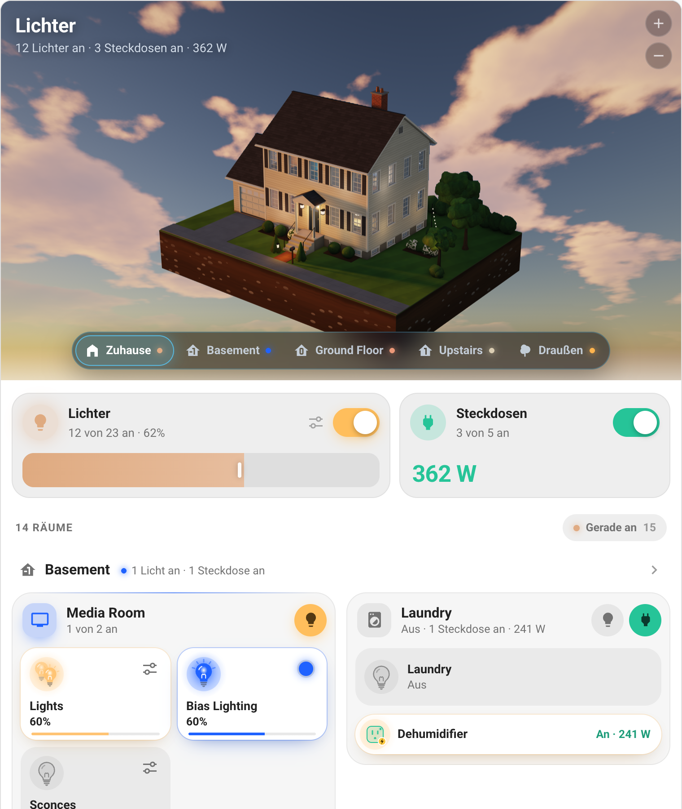

Translations live in [`src/translations`](src/translations). To add a language, copy `en.ts`, translate the strings, and register it in [`src/localize.ts`](src/localize.ts); the tests check that nothing is missing.

## Theming

The card uses your Home Assistant theme's colors, fonts, card background and radius. A few extra variables fine-tune it, each as comma-separated RGB:

| Variable          | Default        | Used for                                         |
| ----------------- | -------------- | ------------------------------------------------ |
| `--lc-holo-rgb`   | `86, 204, 255` | The accent of the floor switcher over the house. |
| `--lc-on-rgb`     | `255, 190, 92` | Light switches that are on.                      |
| `--lc-outlet-rgb` | `38, 196, 152` | Outlets that are on.                             |

```yaml
my-theme:
  lc-holo-rgb: '160, 120, 255'
  lc-outlet-rgb: '0, 150, 255'
```

## Try it without Home Assistant

The repository includes a simulated home (13 areas on three floors, 24 lights and 5 outlets, plus a few hidden and retired devices the card has to skip) for trying the card and for automated tests:

```sh
npm ci
npm run dev
```

Then open <http://localhost:5173/demo/>. The page can also lay the same home out without floors, or without any areas, to show what the card does with them.

## Versions and releases

Every change merged into `main` is tested and released automatically as the next version: 0.1, 0.2 … 0.9, then 1.0, 1.1 and so on. Each [release](https://github.com/kedube/ha-light-control/releases) lists what changed, and HACS offers it as an update.

## Contributing

Bug reports, ideas and translations are welcome. See [CONTRIBUTING.md](CONTRIBUTING.md) for how to build, test and release the card.

## License

[GPL-3.0](LICENSE)
